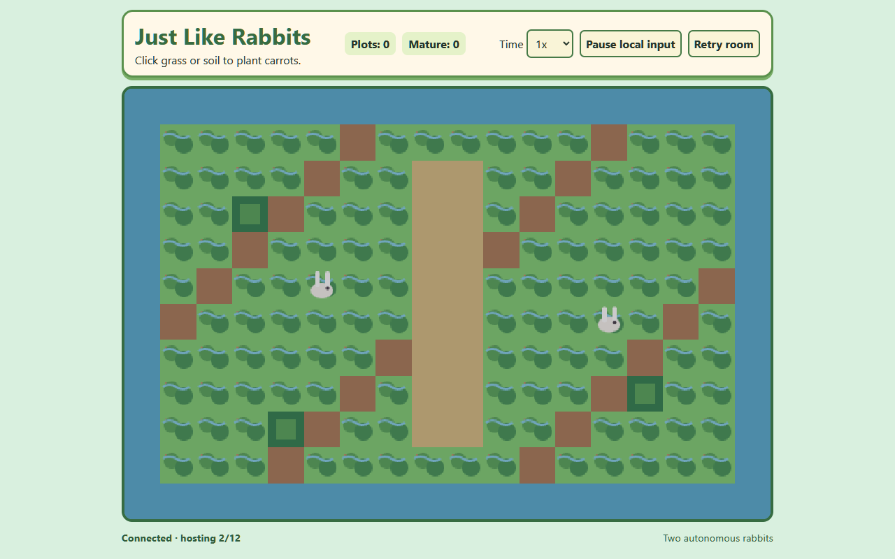

# Just Like Rabbits

A bright, entirely 2D, straight-down rabbit habitat simulation. Plant carrots and watch two independent rabbits wander, hide, rest, and eat. There are no 3D models, perspective effects, angled floor tiles, or billboards.

## Play online

[Open Just Like Rabbits on Vercel](https://just-like-rabbits.vercel.app)

The production build uses the shared `just-like-rabbits` multiplayer service at `https://rmc-colyseus-multiplayer-server.vercel.app`. The Vercel project retains its account deployment protection, so a Vercel-authorized browser is required while that project setting is enabled.

## Run locally

Requires Node.js 24 or newer.

```sh
npm install
npm run dev -- --port 6100
```

Open `http://127.0.0.1:6100/`.

```sh
npm run typecheck
npm test
npm run check:typescript-source
npm run build
```

## Browser requirements

Use a current Chromium-, Firefox-, or WebKit-based browser with Canvas 2D and WebSocket support. The game is pixel-aligned and responsive in both desktop landscape and mobile portrait layouts.



## Controls

- Click or tap an unoccupied grass or soil tile to plant a carrot.
- Clicking water, paths, bushes, or an occupied plot does not change the map and gives subtle feedback.
- Choose `0.5x`, `1x`, `2x`, `4x`, or `10x` to scale the simulation.
- **Pause local input** prevents this browser from sending map actions; it never pauses the shared habitat.
- **Retry room** explicitly reconnects this browser after a room or network error.

The HUD always shows the planted-plot total and mature-carrot total.

## Carrot lifecycle

Planting instantly creates a visible seedling. Each plot has its own timestamp and becomes a mature carrot after exactly 20 seconds of simulation time at 1x. Mature carrots remain until a rabbit eats them. Time scale changes affect the remaining growth time without resetting elapsed simulation time.

## Rabbit behavior

Every session begins with Hazel and Poppy. Each rabbit is an animal, not a player character, and uses these states: `idle`, `wander`, `seekCarrot`, `moveToCarrot`, `eatCarrot`, `hide`, and `rest`.

The fixed-step, seeded rules make choices reproducible. When mature food exists, a rabbit may seek it, move one tile at a time, play its eating frame, and remove the carrot. If a target disappears or cannot be used, it clears that target and returns to another activity instead of retrying forever.

## Art

The art sources are deliberately small, original, and replaceable:

- Environment tileset: [`public/assets/environment-tiles.svg`](public/assets/environment-tiles.svg)
- Rabbit-only sprite sheet: [`public/assets/rabbit-sprites.svg`](public/assets/rabbit-sprites.svg)
- Atlas frame layout, source, and replacement instructions: [`public/assets/ASSETS.md`](public/assets/ASSETS.md)

Both use 32 px frames and are drawn through a pixelated 2D canvas. Replace either atlas without changing rules or state.

## Multiplayer status

The game connects to the shared `just-like-rabbits` Colyseus room at `VITE_MULTIPLAYER_ENDPOINT`, defaulting to `http://127.0.0.1:2567` for local development. The elected host publishes simulation snapshots; guests submit ordered planting and time-scale requests, then render the host's state. The checked-in `vendor/rmc-multiplayer-client-0.9.13.tgz` pins the compatible typed client. Copy `.env.example` to `.env.local` to use another public endpoint.

The server is in-memory. A deploy, expiry, route change, or function/session limit can end a room, so the UI reports reconnection/error states and never promises persistence. On the Vercel Hobby deployment path, bounded sessions must remain below the configured function duration; a fresh room is required after expiry. The integration evidence is in [`docs/multiplayer-server-evidence.md`](docs/multiplayer-server-evidence.md).

## Original request

<details>
<summary>Requested game brief</summary>

```text
Create a fully 2D, top-down rabbit habitat simulation titled “Just Like Rabbits,” with tile planting, 20-second carrot growth, autonomous rabbits, responsive controls, HUD, and shared multiplayer behavior.
```

</details>
